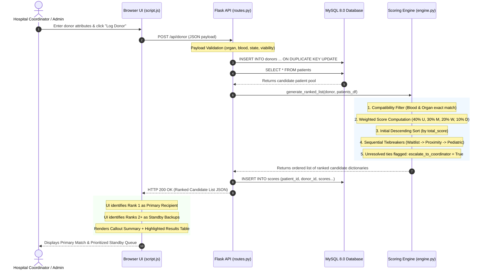

# Unified Organ Allocation System: Architecture, Workflows & Interview Guide

> **Project**: Unified Rule-Based Organ Allocation Prototype  
> **Course**: UCS503 Capstone Project, Thapar Institute of Engineering and Technology  
> **Repository**: [brarprabh/organ-allocation-prototype](https://github.com/brarprabh/organ-allocation-prototype)

---

## 1. Executive Summary & Problem Context

### The Problem in India's Organ Allocation Ecosystem
In India, deceased-organ allocation has historically suffered from state-level fragmentation, lack of standardized national waitlist prioritization, and regional logistical bottlenecks. Often, organs retrieved in one state cannot efficiently be matched to candidates across state borders due to disparate state registries, manual decision-making, and absence of transparent, explainable ranking algorithms. This results in high waitlist mortality alongside tragic organ wastage when ischemic viability windows expire.

### The Solution: Unified Rule-Based Allocation
This prototype implements an **end-to-end, deterministic, multi-factor allocation engine** that:
1. Filters candidates strictly on immunological compatibility (Blood Group & Organ Type).
2. Calculates an explainable, composite allocation score (Urgency, HLA Match, Wait Time, Distance).
3. Applies a sequential tiebreaker protocol to resolve clinical parity.
4. Distinguishes between the **Primary Allocated Recipient (Rank 1)** and the **Prioritized Standby Queue (Ranks 2+)** for a single deceased donor organ.

---

## 2. High-Level System Architecture

The application follows a **Decoupled 3-Tier Architecture**:

```
┌───────────────────────────────────────────────────────────────┐
│                    Presentation Layer (UI)                    │
│      Bootstrap 5 + Vanilla JavaScript (Fetch API, DOM)        │
│       - templates/index.html    - static/script.js            │
└───────────────────────────────┬───────────────────────────────┘
                                │ HTTP / JSON
                                ▼
┌───────────────────────────────────────────────────────────────┐
│                    Application / API Layer                    │
│              Flask Web Framework + Blueprints                 │
│         - app.py (App Factory)   - routes.py (API Endpoints)  │
└───────────────┬───────────────────────────────┬───────────────┘
                │                               │
                ▼ Pure Data (Dicts / DataFrames)▼ Parameterized SQL
┌───────────────────────────────┐ ┌─────────────────────────────┐
│      Core Scoring Engine      │ │      Database Layer         │
│     (Pure Functional)         │ │   MySQL 8.0 (InnoDB)        │
│    - scoring/engine.py        │ │   - db/connection.py        │
│   (Zero Web Dependencies)     │ │   - db/schema.sql           │
└───────────────────────────────┘ └─────────────────────────────┘
```

### Architectural Highlights & Decoupling
- **Pure Functional Scoring Engine**: `scoring/engine.py` has **zero dependencies on Flask or HTTP**. It accepts standard Python dictionaries / pandas DataFrames and returns typed calculation outputs. This ensures **100% unit testability** and allows the scoring engine to be extracted into a background worker (e.g., Celery) without changing a single line of logic.
- **No ORM (Bare-metal SQL)**: Uses `mysql-connector-python` with parameterized queries. Avoids ORM overhead, eliminates hidden N+1 query traps, and prevents SQL injection while maintaining full control over relational integrity and locking semantics.

---

## 3. Detailed Data Flow & Allocation Workflow



---

## 4. Algorithmic Formulation & Scoring Logic

The total score $S_{\text{total}} \in [0.0, 100.0]$ is computed as:

$$S_{\text{total}} = 0.40 \cdot S_{\text{urgency}} + 0.30 \cdot S_{\text{match}} + 0.20 \cdot S_{\text{wait}} + 0.10 \cdot S_{\text{distance}}$$

### 1. Medical Urgency ($40\%$) — $S_{\text{urgency}}$
Reflects mortality risk without immediate transplant:
- **Organ Failure Stage (1–4)**: Scaled to $[25.0, 100.0]$ via $(\text{stage} / 4.0) \times 100.0$.
- **ICU Level**:
  - `Not Admitted`: $0.0$
  - `Standard Ward`: $33.0$
  - `ICU`: $66.0$
  - `Critical Care`: $100.0$
- **Base Urgency**: $0.50 \times \text{Stage Score} + 0.50 \times \text{ICU Score}$.
- **Kidney Dialysis Bonus**: $+15.0$ added for kidney candidates on active dialysis (`dialysis_status == 'Yes'`) to reflect rapid cardiovascular deterioration on chronic hemodialysis.
- **Bounds**: Clamped to $[0.0, 100.0]$.

### 2. Match Quality ($30\%$) — $S_{\text{match}}$
Immunological compatibility based on Human Leukocyte Antigen (HLA) alleles:
- Split comma-separated allele strings for donor ($D$) and patient ($P$).
- Allele overlap ratio:
  $$S_{\text{match}} = \left(\frac{|P \cap D|}{\max(|P|, |D|)}\right) \times 100.0$$
- Minimizes risk of hyperacute and acute graft rejection.

### 3. Waiting Time ($20\%$) — $S_{\text{wait}}$
Rewards accrued waiting list tenure relative to the **current compatible cohort**:
$$S_{\text{wait}} = \left(\frac{\text{days} - \min(\text{wait})}{\max(\text{wait}) - \min(\text{wait})}\right) \times 100.0$$
*(If all compatible candidates share the identical wait time, defaults to $100.0$ for days $> 0$, else $0.0$).*

### 4. Distance Proxy ($10\%$) — $S_{\text{distance}}$
Minimizes Cold Ischemia Time (CIT):
- Same state as donor: $100.0$.
- Different state: $50.0$.
- *(Marked with `# TODO` for future replacement with real geospatial haversine/flight matrix).*

### 5. Sequential Tiebreaker Protocol (`apply_tiebreakers`)
When candidate total scores are identical, ties are resolved sequentially:
1. **Rule 1 (Longer Waitlist Days)**: Candidate with higher `days_on_waitlist` wins.
2. **Rule 2 (Exact Blood Match)**: Documented no-op pass-through in Phase 1 (since exact match filter was pre-applied; preserved for Phase 2 ABO-compatible extensions).
3. **Rule 3 (Geographic Proximity)**: Patient residing in the donor's home state wins.
4. **Rule 4 (Pediatric Priority)**: Candidate under age 18 (`age < 18`) wins (prioritizes developmental potential and life-years gained).
5. **Rule 5 (Coordinator Escalation)**: If all four rules fail to separate candidates, the original order is preserved and `escalate_to_coordinator: True` is flagged for manual clinical review.

---

## 5. Database Schema & Normalization

Designed for **MySQL 8.0 InnoDB**, satisfying Third Normal Form (3NF):

```
┌──────────────────────────┐       ┌─────────────────────────────────────┐
│          states          │       │              hospitals              │
├──────────────────────────┤       ├─────────────────────────────────────┤
│ PK  state_id   (INT, AI) │◄──┐   │ PK  hospital_id    (VARCHAR)        │
│     state_name (VARCHAR) │   └───┼─FK  state_id       (INT)            │
└──────────────────────────┘       │     hospital_name  (VARCHAR)        │
                                   │     hospital_type  (ENUM Gov/Priv)  │
                                   └──────────────┬──────────────────────┘
                                                  │
                   ┌──────────────────────────────┴──────────────────────────────┐
                   │ 1:N                                                         │ 1:N
                   ▼                                                             ▼
┌──────────────────────────────────────┐                       ┌───────────────────────────────────────┐
│               patients               │                       │                donors                 │
├──────────────────────────────────────┤                       ├───────────────────────────────────────┤
│ PK  patient_id   (VARCHAR)           │                       │ PK  donor_id         (VARCHAR)        │
│     name         (VARCHAR)           │                       │     state            (VARCHAR)        │
│     age          (INT)               │                       │ FK  hospital_id      (VARCHAR)        │
│     gender       (ENUM)              │                       │     blood_group      (ENUM)           │
│     state        (VARCHAR)           │                       │     organ_type       (ENUM)           │
│ FK  hospital_id  (VARCHAR)           │                       │     hla_type         (VARCHAR)        │
│     hospital_type(ENUM)              │                       │     logged_datetime  (DATETIME)       │
│     blood_group  (ENUM)              │                       │     viability_hours  (INT)            │
│     organ_needed (ENUM)              │                       └──────────────────┬────────────────────┘
│     hla_type     (VARCHAR)           │                                          │
│     dialysis_stat(ENUM)              │                                          │
│     icu_level    (ENUM)              │                                          │
│     organ_fail_st(INT)               │                                          │
│     days_waitlist(INT)               │                                          │
│     fam_donor_rel(ENUM)              │                                          │
│     registered_dt(DATE)              │                                          │
└──────────────────┬───────────────────┘                                          │
                   │                                                              │
                   │ 1:N                                                      1:N │
                   └──────────────────────────────┬───────────────────────────────┘
                                                  ▼
                                ┌───────────────────────────────────┐
                                │              scores               │
                                ├───────────────────────────────────┤
                                │ PK  score_id        (INT, AI)     │
                                │ FK  patient_id      (VARCHAR)     │
                                │ FK  donor_id        (VARCHAR)     │
                                │     urgency_score   (DECIMAL 5,2) │
                                │     match_score     (DECIMAL 5,2) │
                                │     wait_score      (DECIMAL 5,2) │
                                │     distance_score  (DECIMAL 5,2) │
                                │     total_score     (DECIMAL 5,2) │
                                │     computed_at     (TIMESTAMP)   │
                                │                                   │
                                │ UNIQUE(patient_id, donor_id)      │
                                └───────────────────────────────────┘
```

### Relational Integrity Highlights
- **Composite Unique Constraint**: `UNIQUE(patient_id, donor_id)` on `scores` guarantees that rerunning the ranking algorithm updates existing score records rather than bloating the table with duplicate evaluations.
- **Cascading Deletions**: If a donor or patient record is expunged, historical computed score records cascade cleanly.

---

## 6. Single Donor vs Multiple Candidates: Allocation Semantics

### The Question: "How can a single donor allocate to multiple patients?"
In deceased donor organ transplantation:
1. **Single Organ Supply**: A single donor offers **one organ of a given type** (e.g., 1 heart, 1 liver, or paired kidneys).
2. **Primary Match (Rank 1)**: The candidate who achieves the highest combined score (or wins sequential tiebreakers) is the **Primary Allocated Recipient**.
3. **Standby Queue (Ranks 2+)**: The remaining candidates on the list are **not** allocated the organ simultaneously. They represent the **Prioritized Standby Queue**.
   - If the primary candidate is found acutely infected, declines, cannot be contacted in time, or crossmatch testing is positive at the donor hospital, the organ immediately cascades to **Standby #1 (Rank 2)**, avoiding ischemic expiration.
4. **UI Representation**:
   - Rank 1 is highlighted with a green badge: `Allocated (Primary Recipient)`.
   - Ranks 2+ are styled with neutral badges: `Standby (Backup #1)`, `Standby (Backup #2)`.
   - An **Allocation Callout Card** at the top confirms: *"Single Organ: Kidney (O+) — Primary Match Allocated to Anand Sharma (P072). 31 Standby Backups Queued."*

---

## 7. Interview Questions & Model Answers

### Question 1: "Why did you build the scoring engine as pure functions without Flask dependencies?"
> **Answer**:
> "Separation of concerns. In medical and high-consequence systems, business rules and scoring mathematics should never be coupled to HTTP request lifecycles, headers, or web frameworks. 
> By making `scoring/engine.py` pure functions taking data in and returning data out:
> 1. **Testability**: We can test 100% of the clinical rules using fast pytest assertions without spinning up a web server or mocking HTTP contexts.
> 2. **Portability**: If the system transitions from Flask to FastAPI, AWS Lambda, or an asynchronous worker like Celery or Apache Kafka, the scoring engine code remains untouched.
> 3. **Deterministic Verification**: Pure functions have no side effects, eliminating non-deterministic bugs in clinical audits."

---

### Question 2: "How would you scale this system from 150 patients to 500,000 active patients across India?"
> **Answer**:
> "To scale from prototype to national production:
> 1. **Database Indexing & Partitioning**:
>    - Create composite indexes on `patients(organ_needed, blood_group)` to perform the compatibility filter directly in the DB storage engine in $O(\log N)$ time, avoiding full table scans.
>    - Partition the `patients` table by `organ_needed` (horizontal table partitioning).
> 2. **In-Memory Caching (Redis)**:
>    - Store active patient search vectors in Redis sorted sets or RedisJSON, keyed by `blood_group:organ_needed`.
> 3. **Asynchronous Queue Pipeline (Celery + RabbitMQ)**:
>    - Donor intake (`POST /api/donor`) immediately returns an intake job ID (`202 Accepted`).
>    - Worker nodes ingest the donor, fetch the matching cohort partition, compute scores concurrently using vectorization (NumPy/Pandas C-extensions), and push results via WebSockets to hospital coordinators.
> 4. **Database Read Replicas**:
>    - Route allocation calculation reads to read replicas, reserving the primary master for donor writes and confirmed transplant acceptances."

---

### Question 3: "What happens if two donors are registered simultaneously in different states, and the same candidate ranks #1 for both?"
> **Answer**:
> "This is a classic distributed systems race condition. In this Phase 1 prototype, concurrency locking was explicitly out of scope. In production, we solve this via:
> 1. **Two-Phase Locking (2PL) / Distributed Locks**:
>    - Using Redis Redlock or MySQL row-level pessimistic locks (`SELECT ... FOR UPDATE` on `patients` table).
> 2. **Transplant Offer State Machine**:
>    - When an organ is offered to Rank 1, the patient's state transitions to `OFFER_PENDING` with a strict time-to-respond window (e.g., 60 minutes).
>    - While in `OFFER_PENDING`, the candidate is temporarily suppressed from competing primary allocation lists, or designated as 'Hold'.
>    - If the surgeon accepts, status moves to `ALLOCATED` and they are removed from the active waitlist. If rejected, status returns to `ACTIVE`, and the standby candidate is promoted."

---

### Question 4: "Why did you use min-max normalization for waiting time relative to the compatible cohort rather than a global constant (e.g. 1000 days)?"
> **Answer**:
> "Waitlist tenures differ drastically by organ type and blood group. For example, rare blood groups or pediatric heart candidates may have significantly shorter average wait times compared to adult O+ kidney candidates who might wait 5+ years.
> If we used a fixed global ceiling like 1000 days:
> - In cohorts where the longest-waiting candidate has waited only 90 days, the wait score would be suppressed to under 9%, effectively muting the wait time factor entirely.
> Relative min-max normalization across the compatible cohort ensures that wait time preserves its full intended $20\%$ weight dynamically among the actual candidates competing for that specific organ."

---

### Question 5: "How does the system ensure transparency and explainability?"
> **Answer**:
> "Black-box AI algorithms are unacceptable in organ allocation due to ethical, legal, and life-or-death scrutiny. 
> Our system achieves explainability by:
> 1. Returning **all four individual score components** (`urgency_score`, `match_score`, `wait_score`, `distance_score`) alongside the `total_score` in every API response and UI row.
> 2. Clinicians and auditors can mathematically verify that $\text{total\_score} = 0.40(U) + 0.30(M) + 0.20(W) + 0.10(D)$ down to two decimal places.
> 3. Documenting every tiebreaker step sequentially, with unresolvable ties explicitly escalated to human coordinators rather than arbitrarily broken."

---

### Question 6: "Why did you avoid an ORM like SQLAlchemy?"
> **Answer**:
> "1. **Project Specification**: The capstone requirements explicitly mandated `mysql-connector-python` with parameterized SQL.
> 2. **Performance & Query Clarity**: Raw parameterized SQL gives explicit visibility over indexes, prevents hidden queries (such as lazy-loading loops), and allows clean atomic upserts via `INSERT ... ON DUPLICATE KEY UPDATE`.
> 3. **Minimal Attack Surface**: Without heavy ORM abstractions, the codebase is lightweight, auditable, and has negligible startup latency."

---

## 8. Summary Table of Key Code Files

| File Path | Role & Architectural Responsibilities |
|---|---|
| [`scoring/engine.py`](file:///c:/Users/prabh/OneDrive/Desktop/organ-allocation-prototype/scoring/engine.py) | Pure scoring engine: filter compatible candidates, weighted multi-factor calculation, sequential tiebreakers. |
| [`db/connection.py`](file:///c:/Users/prabh/OneDrive/Desktop/organ-allocation-prototype/db/connection.py) | Context-managed MySQL connection utility with rollback, error handling, and `.env` parameter loading. |
| [`db/schema.sql`](file:///c:/Users/prabh/OneDrive/Desktop/organ-allocation-prototype/db/schema.sql) | DDL for normalized InnoDB tables: `states`, `hospitals`, `patients`, `donors`, `scores`. |
| [`db/load_data.py`](file:///c:/Users/prabh/OneDrive/Desktop/organ-allocation-prototype/db/load_data.py) | Idempotent pandas CSV loader inserting hospitals first, followed by patients and donors. |
| [`routes.py`](file:///c:/Users/prabh/OneDrive/Desktop/organ-allocation-prototype/routes.py) | Flask Blueprint `api_bp` hosting `POST /api/donor` and `GET /api/patients/ranked/<donor_id>`. |
| [`app.py`](file:///c:/Users/prabh/OneDrive/Desktop/organ-allocation-prototype/app.py) | Flask application factory and static/template route host. |
| [`templates/index.html`](file:///c:/Users/prabh/OneDrive/Desktop/organ-allocation-prototype/templates/index.html) | Bootstrap 5 admin view with donor input card, sample presets, and allocation callout. |
| [`static/script.js`](file:///c:/Users/prabh/OneDrive/Desktop/organ-allocation-prototype/static/script.js) | Vanilla JS DOM controller: fetch calls, primary vs standby allocation labeling, table population. |
| [`tests/test_engine.py`](file:///c:/Users/prabh/OneDrive/Desktop/organ-allocation-prototype/tests/test_engine.py) | Pytest suite testing compatibility, scoring formulas, each tiebreaker rule, and integration. |
| [`tests/test_api.py`](file:///c:/Users/prabh/OneDrive/Desktop/organ-allocation-prototype/tests/test_api.py) | Pytest suite validating HTTP response codes, JSON error responses, and payload boundaries. |
